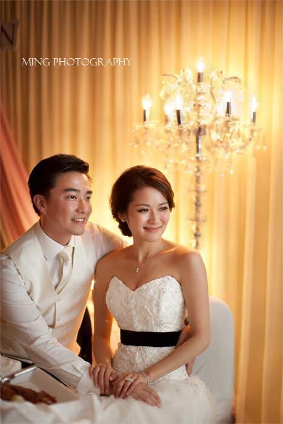
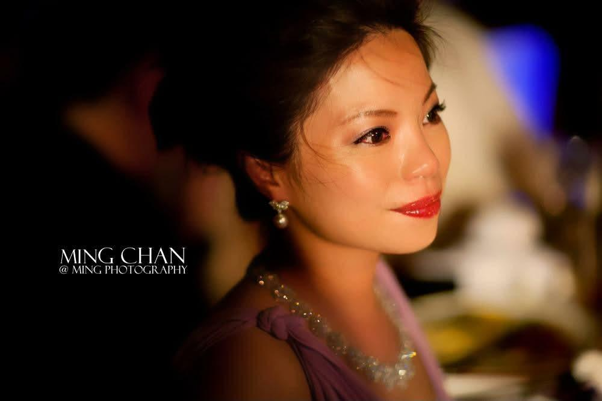
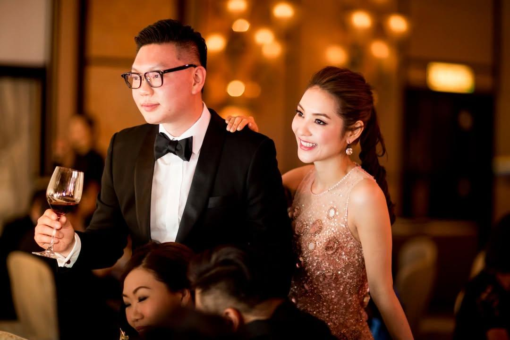
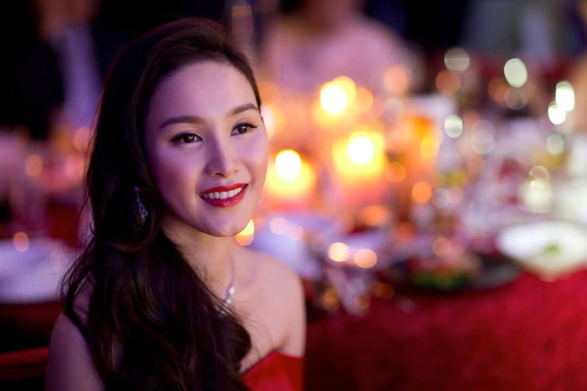

Every photographer carries a distinct philosophy toward light. Recently, I came across a discussion among fellow photographers on using flash as the dominant light source during wedding receptions—neutralizing warm, mixed ambient tones to achieve clean, uniform skin rendering.

While technical clarity has its place, my own approach to evening documentation leans toward restraint.

> True lighting mastery leaves no trace of itself; it simply allows the room’s natural atmosphere to breathe while sculpting quiet depth across a face.

When photographing a wedding banquet, the ambient glow—whether from candlelight, chandeliers, or dim architectural fixtures—is an inseparable part of the memory. Instead of erasing that warmth, I prefer to let off-camera flash weave quietly into the existing light.

By feathering the light and respecting the shadows, the frame retains the genuine mood of the night while giving the subjects natural dimensionality and tonal richness—never announcing the presence of a strobe.

