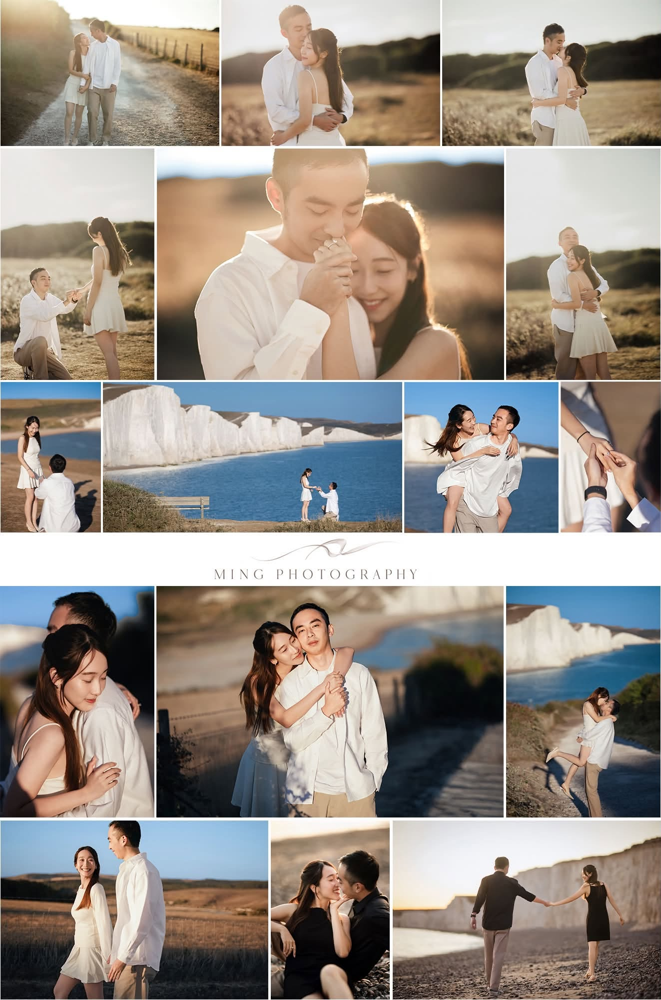
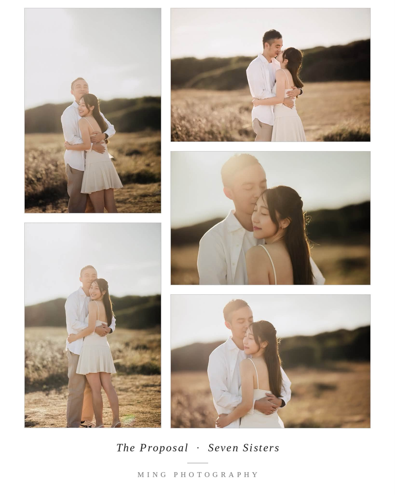
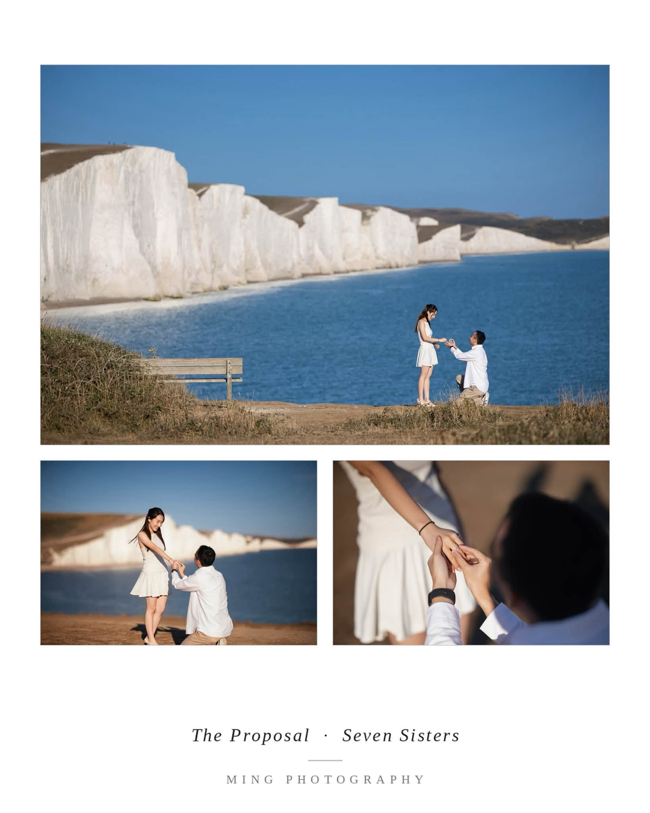

**When Landscape Speaks for Itself**

The chalk cliffs and ocean breeze of Seven Sisters carry an atmosphere of timelessness and quiet grandeur.

When nature speaks with such presence, photography requires no theatrical posing or artificial instruction. When the landscape already tells a story, the rest is left to silent, precise observation.

**Stillness, Space, and Emotion**

For this proposal, we chose to remain quietly in the background at a discreet distance.

By giving Chloe & Perry the space to fully immerse themselves in the tension, surprise, and joy of the moment, we ensured their experience remained entirely undisturbed. To us, the process and genuine feelings always come first.

When distance is maintained, emotion comes through with absolute honesty—the unscripted smiles, the tightly held hands, and the quiet relief after saying "Yes." Every fleeting feeling captured naturally in light and shadow.

**A Memory Preserved in Light**

Thank you, Chloe & Perry, for trusting us to document this unforgettable milestone at Seven Sisters from afar, keeping your story authentic and timeless.
